<p align="center">
  
</p>

<p align="center">
  
  
</p>

---

```ts
const mahdi = {
  location: "Tehran",
  education: "Computer Engineering",
  roles: ["Programmer", "Futures Trader", "Entrepreneur"],
  stack: ["TypeScript", "Angular", "C#", "ASP.NET Core"],
  interests: ["Systems", "Trading", "Business", "Real Estate"],
  motto: "Build first. Explain later.",
};
```

## 🧬 How I Build

```mermaid
%%{init: {'theme':'base','themeVariables':{'background':'#0d1117','primaryColor':'#161b22','primaryTextColor':'#e6edf3','primaryBorderColor':'#1f6feb','lineColor':'#58a6ff','secondaryColor':'#0d1117','tertiaryColor':'#0d1117','clusterBkg':'#0d1117','clusterBorder':'#30363d','fontFamily':'JetBrains Mono, monospace'}}}%%
flowchart LR
  U(["👤 User"])

  subgraph FE["🖥 FRONTEND"]
    direction TB
    A["Angular + TypeScript"]
    B["Components"]
    C["Services / HttpClient"]
    A --> B --> C
  end

  subgraph BE["⚙️ BACKEND"]
    direction TB
    D["ASP.NET Core Web API"]
    E["Controllers"]
    F["Business Logic"]
    G["Entity Framework Core"]
    D --> E --> F --> G
  end

  subgraph DB["🗄 DATA"]
    direction TB
    H[("SQL Server")]
  end

  U --> A
  C -- "REST / JSON" --> D
  G -- "SQL" --> H
  H -. "rows" .-> G
  D -. "response" .-> C
```



## ⚙️ Stack

<p>
  
  
  
  
  
  
  
</p>

## 📊 Stats

<p align="center">
  
  
</p>

<p align="center">
  
</p>

## 📬 Contact

<p align="center">
  <a href="mailto:jalili.mohamadmahdi@gmail.com"></a>
</p>


